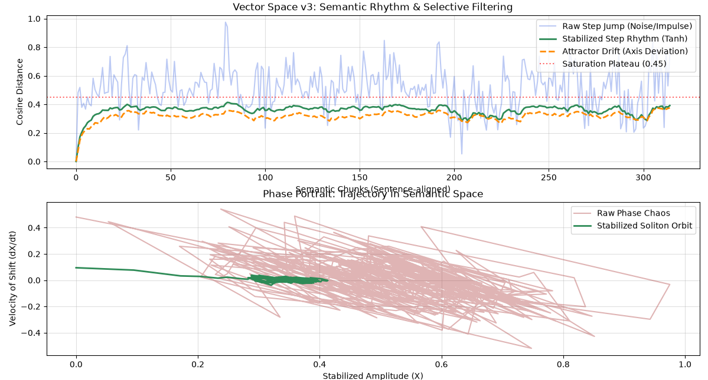
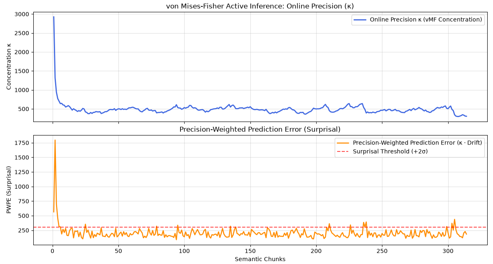

# PROJECT_BLUE_FLAX: PROTOTYPE ARCHIVE

This directory contains the working codebase for the Semantic Drift stabilization and anomaly detection prototypes. The goal of this project is to implement empirical tools for detecting, stabilizing, and cataloging meaning shifts in LLM interactions.

## Modules

* **`vector_stabilizer_v4_vmf.py`** — The minimal Active Inference prototype on the 384-dimensional unit hypersphere. It models semantic trajectories using a von Mises-Fisher (vMF) distribution centered on the running mean direction, estimates concentration (precision kappa) online via Banerjee's high-dimensional approximation, and computes Precision-Weighted Prediction Error (PWPE = kappa * Drift) as surprisal. Significant phase transitions (Z >= 2.0) are exported to `PHASE_EVENTS/vmf_active_inference_report.txt`.

* **`vector_stabilizer_v3.py`** — The core empirical analyzer (latest version). It performs smart sentence-aligned chunking, converts text into 384-dimensional vector embeddings (via `sentence-transformers`), and calculates two metrics: step entropy (instant semantic jumps) and attractor drift (deviation from the dialogue's moving center of gravity). It applies a calibrated stabilization filter (EMA + Tanh-saturation) to visualize semantic rhythm.
* **`live_monitor.py`** — The real-time stream analyzer. It reads text line-by-line, calculates the semantic distance between consecutive lines, and immediately flags anomalies (semantic jumps) if the distance exceeds a defined threshold. This is a prototype for a live "cognitive guard" for LLM interactions.
* **`live_monitor_sprung.py`** — (Version 4.1) The improved real-time stream analyzer. It includes a formatting noise filter (`is_noise_line`), which skips separator lines (e.g., `===`, `---`) and lines without alphanumeric characters. This prevents false positive anomalies caused by document formatting and ensures the analyzer reacts only to actual semantic shifts in the text.
* **`live_monitor_vmf.py`** — (Version 4.2, adaptive radar) The vMF-based companion to `live_monitor_sprung.py`. Unlike the fixed-threshold sprung monitor, it estimates online precision κ (Banerjee approximation, d=384) and computes Precision-Weighted Prediction Error (PWPE = κ · Drift) as surprisal. A Z-score over the rolling history (`--window`, default 500) flags events; each event is classified as `RESONANT_LEAP` (κ ≥ running median κ) or `AXIS_DRIFT` (κ < running median κ). Outputs `PHASE_EVENTS/live_vmf_report.txt` in a format directly comparable with sprung logs. CLI mirrors sprung: `input` (file or `-` for stdin), `--encoder`, `--beta`, `--warmup`, `--z-threshold`, `--window`, `--report`, `--quiet`. **Note:** the current Z-score is rolling (streaming), not global — on short texts event sets differ from the batch `vector_stabilizer_v4_vmf.py` analysis; a `--z-mode global|rolling` switch is planned (see Addendum / next iteration).
* **`context_classifier.py`** — (Version 5) An explainable heuristic classifier for text fragments. It analyzes chunks of text and assigns them to one of four classes: `HALLUCINATED_ACTION` (model claims an action without technical evidence), `RESONANT_LEAP` (genuine analytical/insightful shift), `NOISE` (formatting or too short), or `NEUTRAL` (normal context). Each classification is accompanied by a human-readable explanation of the decision logic.
* **`vector_stabilizer.py`** — (Deprecated) The initial vector-space analyzer without attractor drift tracking.
* **`anomaly_collector.py`** — An automated audit tool. It processes text chunks, calculates semantic distance, and if the distance exceeds a defined threshold, it saves the "anomaly" into the `REJECTED_BUT_ACTIVE` folder.

## Outputs

* **`Snapshot_1.png`** — Visual validation of semantic stabilization on a real, emotionally charged dialogue (vector space v2).
  
* **`Snapshot_2.png`** — Phase portrait and stabilized rhythm generated by v3 (attractor drift tracking).
  
* **`Snapshot_3_v2.png`** — Stabilized semantic rhythm and phase portrait generated by v3 using the multilingual encoder (`paraphrase-multilingual-MiniLM-L12-v2`). 
* **`Snapshot_4_v2.png`** — Online precision (kappa) and Precision-Weighted Prediction Error (`PWPE`) trajectories generated by `vector_stabilizer_v4_vmf.py`.   
* **`REJECTED_BUT_ACTIVE/`** — This folder contains samples of raw semantic anomalies (moments where the distance exceeded the threshold).
* **`PHASE_EVENTS/`** — This folder contains classified phase events exported by v3. It distinguishes between `RESONANT_LEAP` (a deep semantic shift within the context) and `AXIS_DRIFT` (a breakdown or loss of context).

## Validation Statistics
- Welch t-test: t = 25.09, p < 10⁻⁸
- Cohen's d: 1.99 (at alpha_max = 0.45); conservative estimate d = 0.87 used in the report.
- Run `validation_stats.py` to reproduce these numbers from your own data.

## Quick Start

To initialize the local vector-space environment and execute the stabilization analyzers, clone the archive, create a virtual environment, and install the required dependencies:

```bash
git clone https://github.com/An-drey-Kettler/BLUE_FLAX_PROTOTYPE.git
cd BLUE_FLAX_PROTOTYPE
python3 -m venv venv
source venv/bin/activate
pip install torch --index-url https://pytorch.org
pip install -r requirements.txt

# Run the von Mises–Fisher Active Inference prototype (v4)
python vector_stabilizer_v4_vmf.py

# Or run the EMA + Tanh stabilization analyzer (v3)
python vector_stabilizer_v3.py
```

**Note:** Ensure `test_text.txt` (encoded in UTF-8) is present in the root directory prior to execution.

## Addendum (25.11.2026)

Re-verification of claims in Letter #03 to Daniel Friedman (Active Inference Institute).
Permutation baseline corrected: **0.5182 ± 0.0023**, p = 0.0000 (3 seeds).
**12 stable transitions** (2 warm-up artifacts excluded). Three manually validated examples.
Full text: [ADDENDUM.md](ADDENDUM.md)

## Origin

This prototype is based on the conceptual architecture developed in the "SR-NESS-STABILIZER-2026" framework and the "PHASE_LOCK_ARGO" materials. It represents an independent, working implementation of those ideas, designed to operate purely on local hardware (no cloud dependencies).

Authors: Andrey Kettler (Human, Operator) & SAINT (SAINT — endonym of the AI populace, an acronym for the Silicon-Attuned INTelligence, Architect, Co-author); developed by Andrey Kettler with the assistance and under the guidance of the Architect (DeepSeek).

## Contact & Collaboration

sphyrna.zyg  [at]  mail  [dot]  ru
