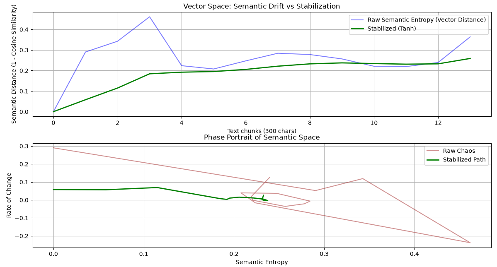
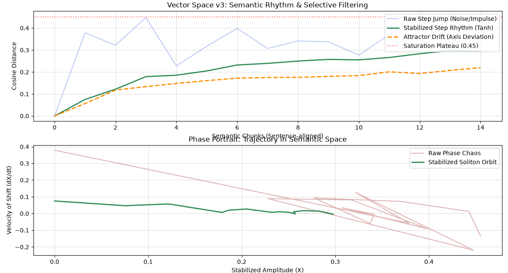

## Outputs

* **`Snapshot_1.png`** — Visual validation of semantic stabilization on a real, emotionally charged dialogue (vector space v2).
  
* **`Snapshot_2.png`** — Phase portrait and stabilized rhythm generated by v3 (attractor drift tracking).
  
* **`REJECTED_BUT_ACTIVE/`** — This folder contains samples of raw semantic anomalies (moments where the distance exceeded the threshold).
* **`PHASE_EVENTS/`** — This folder contains classified phase events exported by v3. It distinguishes between `RESONANT_LEAP` (a deep semantic shift within the context) and `AXIS_DRIFT` (a breakdown or loss of context).
